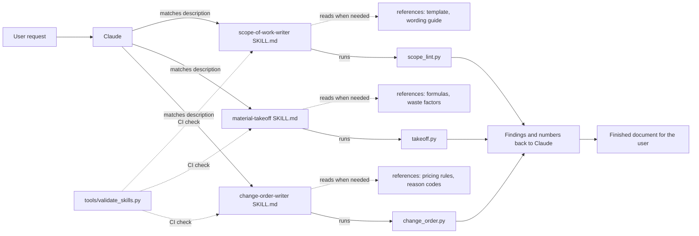

# trades-skill-pack

Remodeling paperwork goes wrong in two places: vague scopes, and arithmetic done from
memory. This pack is for remodeling contractors, and the teams building tools for them,
who use Claude to draft job documents. It gives Claude three skills:

- **Scope of work**: drafts the scope, then a checker flags missing sections (exclusions,
  assumptions, change process), vague wording such as "as needed" or "TBD", allowances
  with no dollar amount, and payment schedules that do not add up to 100%.
- **Material takeoff**: turns room dimensions into an order list for drywall, tile, paint
  and baseboard, with waste added and quantities rounded up to whole sheets, boxes,
  gallons and sticks.
- **Change order**: prices adds and credits, applies markup and material tax, and prints
  a ready to sign document with the revised contract sum.

Claude writes the words. A small Python script does every number and every check, so the
same input always gives the same output. This is a portfolio build with invented sample
data. It has not been used on a live job.

## What you will see

Real output from `python demo/run_demo.py` (offline, no keys). Full capture:
[demo/output.txt](demo/output.txt).

```text
Item                                       Net  Waste  Order Unit
Drywall sheets 4x8                  225.32 sqft    10%      8 sheet  (sample $120.00)
Tile 12x24 in, straight lay            40 sqft    10%      3 box  (sample $144.00)
Paint, 2 coat(s)                    225.32 sqft     5%      2 gallon  (sample $76.00)
Baseboard, 16 ft sticks                23.5 lf    10%      2 stick  (sample $44.00)

- Net material: $50.00
- Net labor: $420.00
- Markup: $70.50
- Material tax: $4.00
- **This change order: $544.50**

ERROR   missing-section       Missing required section: Exclusions
WARNING vague-phrase          line 9: Vague phrase 'as needed': say exactly what is included
ERROR   allowance-no-amount   line 14: Allowance has no dollar amount
ERROR   payment-sum           Payment schedule adds up to 90%, not 100%
scope lint: 5 error(s), 3 warning(s)
```

The three blocks are the takeoff for a sample 8 ft by 5 ft bath, the price section of a
sample change order, and five of the eight findings on a deliberately flawed scope draft.

## What is in the repo

Three Claude Agent Skills. Each is a folder with a `SKILL.md` (YAML frontmatter plus a
workflow), reference docs loaded only when needed, and a deterministic Python helper
that uses the standard library only.

| Skill | Writes | Helper script |
|---|---|---|
| `scope-of-work-writer` | A scope with inclusions, exclusions, allowances, assumptions, schedule, payment schedule and change process | `scope_lint.py`: required sections, vague phrases, allowance amounts, payment percentages add up to 100 |
| `material-takeoff` | An order list for drywall, tile, paint and baseboard | `takeoff.py`: geometry, waste factors, round up to whole sheets, boxes, gallons and sticks |
| `change-order-writer` | A change order with adds, credits, a revised contract sum and signature lines | `change_order.py`: Decimal money math, markup, material tax, markdown document |

`tools/validate_skills.py` checks each skill against the published Agent Skills format
(name of 64 characters or fewer in lowercase letters, numbers and hyphens, no reserved
words, description of 1,024 characters or fewer, no XML tags, links resolve). Format
rules were checked against the Agent Skills overview documentation on 2026-11-24.

**All prices, quantities, waste factors and rates in this repository are sample values
invented for illustration.** They are labelled SAMPLE where they appear. Nothing here is
a quote or a trade standard.

## Architecture



The model writes the words. The scripts own the numbers and the checks, so the same input
always gives the same output.

## Run it

```bash
python -m venv .venv && . .venv/bin/activate   # Windows: .venv\Scripts\activate
pip install -r requirements-dev.txt
python demo/run_demo.py
```

The helper scripts themselves need no install at all (Python 3.10 or newer):

```bash
python skills/material-takeoff/scripts/takeoff.py skills/material-takeoff/examples/sample_room.json --table
```

To use a skill in Claude Code, copy its folder into `.claude/skills/` (project) or
`~/.claude/skills/` (personal). For claude.ai, zip one skill folder and upload it in
settings. For the API, upload it through the Skills API. These install routes are the
documented ones. This repository does not automate or test them.

## Tests

```bash
python -m pytest -q
```

57 tests, about a second, no network. They cover the calculators (rounding, waste, bad
input including NaN and Infinity), the change order math (credits, markup and tax rules,
half up rounding), the scope linter, the skill format validator, and a check that the
repository contains no em dashes. CI runs the validator, the tests and the demo on
Python 3.10 and 3.12 (`.github/workflows/ci.yml`).

## Demo

`python demo/run_demo.py` runs offline with no keys. It validates the three skills, runs a
takeoff for a sample 8 ft by 5 ft bath, renders a sample change order, lints a clean
sample scope, then lints a deliberately flawed draft to show the findings. It runs the
helper scripts directly. It does not call Claude.

## Where this pattern comes from

The layout (a short skill file that routes to reference docs and a deterministic script)
is one the author uses in day to day operations work for small service businesses. That
is background, not evidence: the code and every value here were written fresh for this
repository, and no client, job or result is claimed.

## Limitations

What has never been run:

- No model is called anywhere in this repository. The tests and the demo run the helper
  scripts and the format validator only. How reliably Claude triggers each skill, follows
  its workflow, or writes a good scope was not measured.
- Uploading the skills to claude.ai or through the Skills API was not exercised here.
- Nothing has been used on a live job, and there are no integrations (no estimating,
  accounting or supplier systems).

What the calculators do not do:

- Rooms are plain rectangles. L shapes, vaulted ceilings and stairs must be split up by
  hand and run in parts. Adding the rounded parts can order a unit more than one
  combined run would.
- The takeoff covers drywall sheets, tile, paint and baseboard only. No compound, tape,
  fasteners, thinset, grout, primer, casing or crown.
- Tile and baseboard use the whole floor and the whole perimeter unless told otherwise.
  The sample bath does not deduct the tub or the vanity, so its tile and trim counts run
  high for a real bath. Pass `area_sqft` for tile to correct that.
- Drywall area is net of door and window openings. Many estimators do not deduct small
  openings. The 10% sample waste is the only cushion.
- Waste factors and paint coverage are sample defaults, not measured data.
- Change order rules (markup on positive net only, tax on net material only, no tax on
  markup or labor) are one convention. A real contract may say otherwise, and tax
  treatment varies by place.
- Units are US customary (feet, inches, gallons) and money is in dollars.

What the checkers cannot see:

- The scope linter matches headings and phrases. A section titled "Payment terms"
  instead of "Payment schedule" is reported as missing. Every percentage in the payment
  section is summed, so a late fee written as a percent there trips the 100% check.
- It cannot tell whether a scope is correct or complete for a real job, and it is not
  legal advice.
- The format validator uses a simple `key: value` frontmatter parser, not a full YAML
  parser, and covers the documented name and description rules only.

License: MIT, see the LICENSE file.
