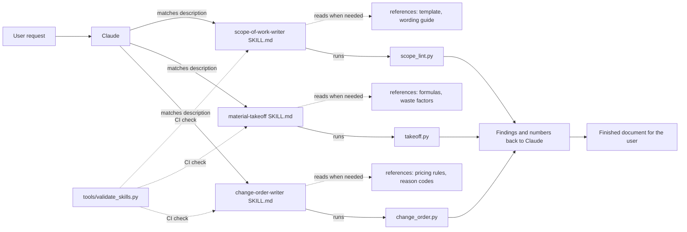

# trades-skill-pack

Remodeling paperwork goes wrong in two places: vague scopes and arithmetic done from memory.
This pack gives Claude three skills that write the documents and hand every number to a small script.

## What it does

Three Claude Agent Skills for residential remodeling. Each is a folder with a `SKILL.md`
(YAML frontmatter plus a workflow), reference docs loaded only when needed, and a
deterministic Python helper that uses the standard library only.

| Skill | Writes | Helper script |
|---|---|---|
| `scope-of-work-writer` | A scope with inclusions, exclusions, allowances, assumptions, schedule, payment schedule and change process | `scope_lint.py`: required sections, vague phrases, allowance amounts, payment percentages add up to 100 |
| `material-takeoff` | An order list for drywall, tile, paint and baseboard | `takeoff.py`: geometry, waste factors, round up to whole sheets, boxes, gallons and sticks |
| `change-order-writer` | A signed change order with adds, credits and a revised contract sum | `change_order.py`: Decimal money math, markup, material tax, markdown document |

`tools/validate_skills.py` checks each skill against the published Agent Skills format
(name of 64 characters or fewer in lowercase letters, numbers and hyphens, no reserved
words, description of 1,024 characters or fewer, no XML tags, links resolve). Format
rules were checked against the Agent Skills overview documentation on 2026-11-24.

**All prices, quantities, waste factors and rates in this repository are sample values
invented for illustration.** They are labelled SAMPLE where they appear. Nothing here is
a quote or a trade standard.

## Architecture



The model writes the words. The scripts own the numbers and the checks, so the same input
always gives the same output.

## Run it

```bash
python -m venv .venv && . .venv/bin/activate   # Windows: .venv\Scripts\activate
pip install -r requirements-dev.txt
python demo/run_demo.py
```

The helper scripts themselves need no install at all (Python 3.10 or newer):

```bash
python skills/material-takeoff/scripts/takeoff.py skills/material-takeoff/examples/sample_room.json --table
```

To use a skill in Claude Code, copy its folder into `.claude/skills/` (project) or
`~/.claude/skills/` (personal). For claude.ai, zip one skill folder and upload it in
settings. For the API, upload it through the Skills API.

## Tests

```bash
python -m pytest -q
```

The tests cover the calculators (rounding, waste, bad input), the change order math
(credits, markup and tax rules, half up rounding), the scope linter, the skill format
validator, and a check that the repository contains no em dashes. CI runs the validator,
the tests and the demo on Python 3.10 and 3.12 (`.github/workflows/ci.yml`).

## Demo

`python demo/run_demo.py` runs offline with no keys. It validates the three skills, runs a
takeoff for a sample 8 ft by 5 ft bath, renders a sample change order, lints a clean
sample scope, then lints a deliberately flawed draft to show the findings. Captured
output is in [demo/output.txt](demo/output.txt). Excerpt:

```text
Item                                       Net  Waste  Order Unit
Drywall sheets 4x8                  225.32 sqft    10%      8 sheet  (sample $120.00)
Tile 12x24 in, straight lay            40 sqft    10%      3 box  (sample $144.00)
```

## Where this pattern runs

This layout (a short skill file that routes to reference docs and a deterministic
script) is drawn from systems that run two small service companies day to day, where
scopes, takeoffs and change orders are produced every week. The code and every value
here were written fresh for this repository.

## Limitations

- Rooms are plain rectangles. L shapes, vaulted ceilings and stairs must be split up by
  hand and run in parts.
- The takeoff covers drywall sheets, tile, paint and baseboard only. No compound, tape,
  fasteners, thinset, grout, primer, casing or crown.
- Waste factors and paint coverage are sample defaults, not measured data.
- Change order rules (markup on positive net only, tax on net material only) are one
  convention. A real contract may say otherwise, and tax treatment varies by place.
- The scope linter matches headings and phrases. It cannot tell whether a scope is
  correct or complete for a real job, and it is not legal advice.
- The format validator uses a simple `key: value` frontmatter parser, not a full YAML
  parser, and covers the documented name and description rules only.
- The skills were validated for format and their scripts are tested. How reliably a model
  triggers and follows each skill was not measured here.
- Units are US customary (feet, inches, gallons) and money is in dollars.

License: MIT, see the LICENSE file.
